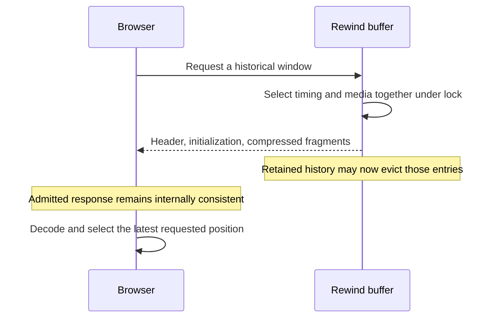

# Rewind playback incident and troubleshooting

This guide describes playback failures and the fixes that help diagnose similar symptoms. It supplements the [live rewind guide](live-rewind.md). The confirmed software failures were false missing-footage messages, repeated loading near the oldest edge or during startup, retained live pictures appearing over historical playback, and a live synchronization regression that repeatedly replayed older pictures.

Different timestamps burned into camera pictures can reflect differences between the cameras’ clocks. Use a moving object in overlapping views to evaluate physical alignment.

## Four clocks with different jobs

| Clock | What it describes | How the application uses it |
| --- | --- | --- |
| Camera/NVR picture timestamp | The date and time drawn into the video pixels by the source | It is visible to the viewer; the application neither reads it nor uses it to calculate camera offsets. |
| MP4 media time | Presentation position within one encoded stream | The decoder uses it to select frames. Independent cameras and reconnects can have different media origins. |
| Server production UTC | When a completed encoded fragment was produced, before hub or browser delivery | The server estimates a mapping from media time to UTC and source pace. This is a proxy for capture time. |
| Browser playback cursor | The selected historical UTC position, advanced by elapsed browser time and signed speed | Every visible historical player converts this shared position back to its own media timeline. |

For one fragment, the mapping is approximately `UTC = origin + mediaSeconds × clockRate × 1000`. Historical playback uses its inverse, rather than applying the same media position to every camera. A short set of consistent production intervals estimates source pace; isolated flushing delays should not redefine that pace. Startup refinement can improve retained metadata before calibration settles.

Production UTC cannot reveal an unknown delay before the fragment was produced. Camera encoding, NVR buffering, RTSP delivery and server processing can differ between streams. Aligning the server media timeline therefore does not prove simultaneous sensor capture. A wrong printed clock can change the label without changing the order of events in the footage.

To assess physical alignment, compare the same moving object against a fixed landmark visible in overlapping views. Account for perspective: equal pixel positions in different pictures are not equal positions on the road. A short recording spanning the event is stronger evidence than isolated screenshots. Compare a direct camera/NVR viewer with the application, and compare live with rewind. Do not add fixed camera offsets based solely on printed timestamps.

## What failed and how it was repaired

### Independent media timelines and live synchronization

The fix introduced per-fragment production-to-media mapping for rewind, exports and encoded live playback. A shared UTC position accounts for different media origins and source pacing. Previously, encoded live players largely played near their own newest media independently.

The initial shared live clock recalculated its anchor as incoming fragment duration and delay estimates changed. Ordinary short/long fragment alternation could repeatedly move the target backwards, then advance it again. The source's printed time consequently jumped backwards and forwards even during ordinary live viewing. This was a software regression introduced during the synchronization work.

The fix made an established live cursor advance by elapsed time, holding during underruns. A camera ahead of that cursor holds its picture until the cursor catches up instead of seeking backwards to repair normal jitter. Held native video continues checking the clock even when paused video emits no compositor callbacks. Membership changes and reconnects can still establish a new live anchor; the continuous-stream guarantee does not make reconnects seamless.

This repair removed the reproduced oscillation. It did not prove that all physical camera events were synchronized, and the original vehicle screenshots did not justify confidently blaming the cameras.

### Coverage disagreed with seek availability

Compressed media could be contiguous while adjacent production-time mappings had a small gap. Earlier coverage reporting could advertise a position as retained, while playlist selection rejected that same position with HTTP 410. The browser reset its decoder and retried, producing flickering missing-footage messages.

The fix made coverage, playlist selection and replay export use the same normalized playback view. Contiguous media boundaries with positive production gaps within the existing 100 ms uncertainty tolerance are mapped continuously. This adjusts the UTC mapping; it does not create or duplicate compressed frames. Larger gaps, reconnects and genuinely missing compressed media remain unavailable. Dependent frames after missing media become playable at the next usable keyframe.

### A playlist could expire before its media arrived

The browser formerly made separate requests for a playlist, codec initialization and each fragment. A successful playlist response did not reserve the referenced bytes. At the oldest edge, the server could evict those fragments before the following requests arrived. During startup, timing refinement could also change the view between requests. The browser then discarded its decoder after a later request failed.

The fix introduced a complete-window response. Selection captures matching playlist metadata, initialization and fragment references under the rewind buffer lock. The response then streams those admitted references. Later ordinary eviction or timing refinement cannot substitute newer media or invalidate that in-flight window. A request that is already outside coverage at admission still correctly returns 410.

The binary body contains a four-byte unsigned little-endian JSON header length, the UTF-8 header, initialization bytes and fragment bytes in playlist order. The [API contract](live-rewind.md#api-and-access) describes the fields. The browser rejects malformed lengths, truncated bodies, inconsistent fragment counts, invalid identities and invalid timing instead of inventing a playback target. Existing playlist and individual-fragment endpoints remain supported, but the maintained browser uses complete windows.

### Loading chased a moving target

A newly started server has only a short window. While that window was downloading, the shared browser target could advance beyond its end. The old path discarded the downloaded media, started another load and repeated. A full buffer's middle often worked because the fetched window already covered the newer target.

PR #301 preserves the admitted decoder and compressed history, hides the picture while the target is unavailable, and extends the same stream as new footage arrives. Optional forward read-ahead requests the next needed portion rather than refetching an expired oldest position. A 410 from optional read-ahead refreshes server coverage without destroying an already decoded, playable selection. True required-load failures still report unavailability. A fresh coverage boundary can trigger an immediate retry.

### A retained live picture leaked into historical playback

Suspending native or software grid playback deliberately preserved its last live picture on a canvas. Historical loading removed the historical-ready class, revealing that retained grid canvas. An enhanced picture or zoom source could similarly select retained live media while the requested historical frame was missing. A tile could therefore say **NO FOOTAGE** while displaying a much newer picture that remained unchanged across screenshots. That appearance was not proof that a live stream was actively playing inside the rewind decoder.

PR #301 gives historical playback exclusive picture ownership. JPEG images, native grid video and retained software/native canvases stay hidden during rewind. Enhancement and zoom stop selecting live sources while historical video is unavailable. Historical-ready state is shown only after the player has a valid requested position and the decoder is ready and no longer seeking. Loading, gaps, late decoder events and disposal cannot reveal a retained live picture.

## Expected behavior and warning signs

| Observation | Interpretation or next check |
| --- | --- |
| One camera has footage at the absolute oldest position; others show no footage | The grid slider spans the earliest retained start to the latest retained end across the server snapshot, not the intersection where all cameras have footage. Check each camera's ranges. Different bitrate, keyframe boundaries, memory pressure or startup times can produce different starts. |
| A paused oldest position advances with an expiry message | Rolling retention has overtaken the selected position. The controller moves to the earliest retained position and stays paused. Saving a replay is the way to preserve footage permanently. |
| A camera briefly shows loading after a seek | The requested historical window is being loaded or decoded. No live picture should appear while that happens. |
| A sleeping/offline camera shows no footage | It has no retained coverage at the selected time. Rewind does not wake it or fill its missing intervals. |
| The time label jumps backwards during reverse scanning or after a manual seek | That follows the selected direction or seek. Repeated backwards jumps during uninterrupted forward/live playback require investigation. |
| The printed timestamps differ by seconds, but a moving object lines up in overlapping views | Investigate source clock labels separately. The label mismatch alone is not a playback synchronization measurement. |
| A tile reports no footage but shows a much newer, frozen scene | Suspect picture ownership or stale enhancement/zoom output. Compare the selected time, badge and picture, then check whether retained live elements are visible. |
| Footage repeatedly disappears and reloads while playing a covered interval | Check per-camera ranges, window requests, decoder errors and transport delay. Repeated complete-window loads or 410s within current coverage are useful evidence. |
| All decoded streams pause briefly near the recent edge | They may be waiting for the shared live cursor or additional fragments. Persistent stalls or recurring forward/backward picture jumps need diagnosis. |
| A **REC ERROR** badge appears | Permanent recording is a separate pipeline. Inspect its error independently; healthy rewind is not evidence that archive recording succeeded. |

Retention uses duration and bytes independently. Increasing seconds alone does not enlarge a memory-limited history window. Eviction removes compressed entries and preserves a decodable beginning; it is not guaranteed to retain exactly the requested number of seconds on every camera.

Complete-window admission does not hold the entire history or introduce a persistent reservation. It holds references for the active response. Already evicted bytes can therefore remain alive until that response finishes or is cancelled, in addition to the configured retained-history budget. Browser decoding also uses memory outside the server's retention budget. Watch request latency, concurrent viewers and host memory when choosing capacity.

## Reproduction and verification checklist

Use a separate test server and generated cameras for restart, reconfiguration, sleeping-camera and fault-injection checks. Restarting the production server or changing rewind settings clears history and can interrupt recording; these are not necessary merely to inspect normal playback.

1. Test the deployed build with a fresh browser page. An already open page can still run older JavaScript after a server update. Confirm the browser requests the complete-window endpoint.
2. Play from the middle, then the exact oldest position. Observe the selected time, camera badges and pictures together. Test slightly inside each camera's actual retained start as well as the grid's global oldest position.
3. Leave forward playback near the oldest edge while the server continues capture and eviction. It should retain historical ownership; genuine gaps should remain empty.
4. Pause in a covered middle position, seek while paused, and resume. Separately let a paused oldest position expire: it should move to retained coverage while staying paused.
5. Exercise reverse scanning, speed presets and repeated ten-second seeks. Reverse intentionally uses paused native video with seeks and is muted; it is not smooth native reverse playback.
6. Switch between focused-camera and grid views, then return to live. Time, direction and pause should survive view changes; released players must not restore pictures after disposal.
7. On the isolated test server, seek while a very short buffer is filling and delay delivery of an already admitted window. The newer target should extend the same media source rather than repeatedly discard it.
8. On the isolated test server, evict by both time and memory, reconnect with a new stream epoch, and cancel an admitted transfer. New requests should respect actual availability; admitted responses should preserve their own metadata and media.
9. Test enhancement and zoom with historical loading, real gaps and late decoder events. No retained live source should cover the historical placeholder.
10. For event synchronization, capture a moving landmark event in overlapping views and compare a direct viewer, application live, rewind and saved replay. Record conclusions separately from clock-label differences.

## Automated regression coverage

| Test source | Evidence it checks |
| --- | --- |
| [Rewind controller tests](../tests/web-live-rewind.test.cjs) | Shared historical UTC, different media origins/paces, gaps, boundaries, malformed envelopes, expired read-ahead, advancing targets during loading, coverage retries and epoch isolation. |
| [Live clock tests](../tests/web-live-camera-sync.test.cjs) | Short/long fragment alternation, steady cursor progress, holding ahead cameras, underruns, membership changes, source reconnects and rate compensation. |
| [C# rewind window tests](../tests/SecurityCameraViewer.Web.Tests/RewindWindowTests.cs) | Matching metadata/media admission, time and memory eviction, startup refinement, keyframe dependencies, response framing and cancellation. |
| [C# rewind buffer tests](../tests/SecurityCameraViewer.Web.Tests/LiveRewindTests.cs) | Retention budgets, playable ranges, epochs, sleep, encoder sharing and true unavailable boundaries. |
| [HTTP/media tests](../tests/SecurityCameraViewer.Web.Tests/LiveMediaTests.cs) | Generated RTSP video/audio decoding through actual endpoints, authentication, same-origin checks, expired windows and channel isolation. |
| [Chromium playback tests](../tests/test_playback_controls_browser.mjs) | Real generated H.264 decoding, historical loading visibility, filling-window extension, reverse scanning, timing boundaries and transport interactions. |
| [Enhancement tests](../tests/web-camera-enhancements.test.cjs), [zoom tests](../tests/web-camera-zoom.test.cjs) | Historical source selection and resource lifecycle when decoded history is unavailable. |

PR #301 validation passed 379 browser unit tests, 26 Chromium tests, 544 C# rewind/export assertions and 78 additional HTTP/media checks. These are recorded results for that revision, not a permanent expected count. Test commands and dependencies are in the [live rewind verification guide](live-rewind.md#verification).

Unit tests establish the logic with controlled clocks and transport. Real Chromium tests add decoder and rendered-picture checks; HTTP tests add server/media behavior. None of these measure unknown delays in a physical camera or NVR. Device testing is still required for that question, Linux host behavior and mobile browser compatibility.

## What to capture if it recurs

Record the build/revision, browser and playback method; whether the buffer was filling or full; selected time, direction and speed; whether the failure occurred at the global oldest point or a camera-specific boundary; and the camera badge and picture at the same moment. Note whether enhancement, zoom, sound or a view change was involved.

The read-only `GET /api/playback` response gives connection generation, settings, byte usage and per-camera epoch/ranges. Compare the selected UTC position against those ranges. A reported range start is inclusive and its end is exclusive. Do not substitute a printed camera timestamp for the selected UTC position.

For a failed window, record its channel/epoch, requested timestamp, HTTP status and duration. A 410 outside current coverage is expected; 400 indicates invalid input; 401/403 concern access rather than retention. Keep a short reproduction and the relevant console/media error. If a decoder has playable data but repeatedly replaces its media source, investigate the loading state machine. If the badge says no footage while live media remains visible, investigate rendering ownership.

Keep camera credentials, private URLs, household footage and unredacted configuration out of public issues or committed test fixtures. Preserve raw evidence privately and use generated media for regression tests. Include enough relative timing and range information to reproduce the failure without publishing the camera feed.

## Code boundaries to preserve

The [rewind buffer](../src/SecurityCameraViewer.Web/LiveRewindBuffer.cs) owns retention, epoch identity, decodable selection and normalized availability. The [window result](../src/SecurityCameraViewer.Web/RewindPlaybackWindowResult.cs) owns response framing and streaming. The [browser rewind player](../src/SecurityCameraViewer.Web/wwwroot/live-rewind.js) owns asynchronous loading, decoder lifetime and historical presentation. The [live frame clock](../src/SecurityCameraViewer.Web/wwwroot/camera-frame-clock.js) owns production-time mapping and shared live scheduling.

Future changes must keep advertised coverage and actual selection consistent, admit matching metadata and compressed media together, preserve a usable decoder during optional loading, and prevent live sources from becoming historical fallbacks. Never mix initialization and fragments from different epochs. Once a continuous live cursor is established, ordinary fragment jitter must not move it backwards. Keep physical capture-time claims separate from what production timestamps and tests actually establish.
